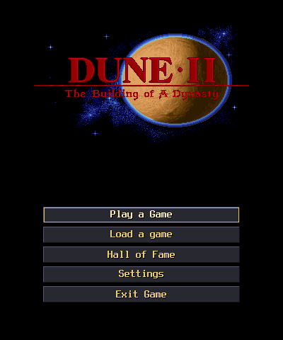
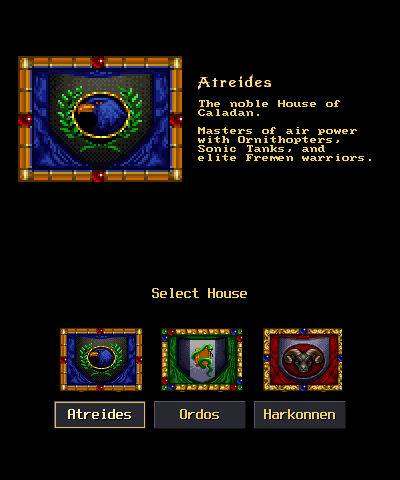
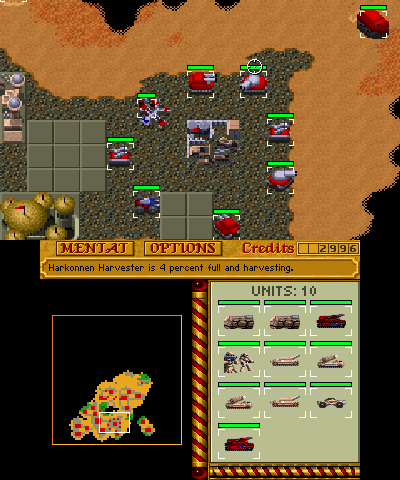
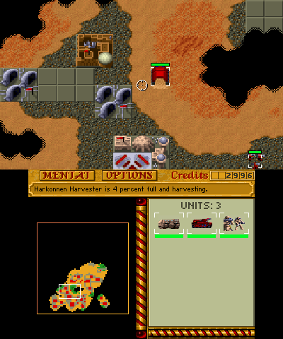
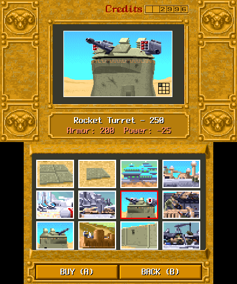
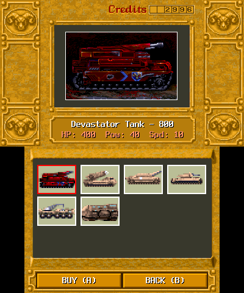
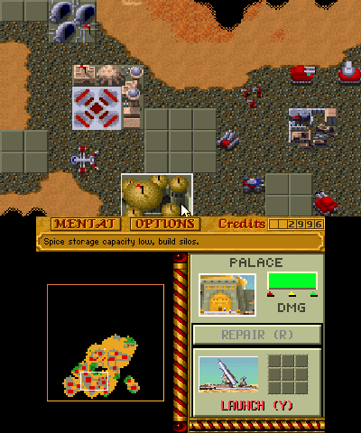

<p align="center">
  
</p>

<h1 align="center">OpenDUNE3ds (Dune II for Nintendo 3DS)</h1>

<p align="center">
  <strong>The 1992 godfather of real-time strategy, rebuilt around Nintendo 3DS's two screens and modern handheld controls.</strong>
</p>

<p align="center">
  <a href="https://github.com/Karolynaz/OpenDUNE3ds/releases/latest"><strong>Download Latest Release (.cia &amp; .3dsx)</strong></a>
  &nbsp;·&nbsp;
  <a href="#screenshots">Screenshots</a>
  &nbsp;·&nbsp;
  <a href="#installation">Installation</a>
  &nbsp;·&nbsp;
  <a href="#controls">Controls</a>
  &nbsp;·&nbsp;
  <a href="#whats-next">What's Next?</a>
</p>

---

If you grew up conquering Arrakis in *Dune II: The Building of a Dynasty*, you know two things about it: it invented the modern RTS blueprint, and playing it with 1992 single-unit clicks on a tiny cramped screen does *not* age gracefully.

**OpenDUNE3ds** brings Westwood's classic to the Nintendo 3DS (based on [OpenDUNE](https://github.com/OpenDUNE/OpenDUNE)) without forcing a desktop interface onto a handheld. The **top 400 × 240 screen** is dedicated entirely to the battlefield—no clutter, no squeezed sidebars—while the **bottom 320 × 240 touchscreen** becomes a true command dashboard with a live touch-draggable radar, credits and power readouts, squad health cards, unit/building portraits, and redesigned production menus.

Whether you are deploying Atreides Sonic Tanks, sneaking Ordos Deviators, or arming a Harkonnen Death Hand from your Palace on Level 9, everything is tuned so you can command an entire desert army comfortably from the couch.

---

## Screenshots

All screenshots below were captured directly from the Nintendo 3DS build running in emulation (including late-game Level 9 saves).

### Title Screen & House Selection

| Title Screen | House Selection |
| :---: | :---: |
|  |  |
| *Title menu* | *House selection* |

### Gameplay

| Multi-Unit Selection | Spice Harvesting |
| :---: | :---: |
|  |  |
| *Harkonnen units* | *Harvesting * |

### Building Construction, Buying Tanks & House Palace

| Construction Yard Menu | Heavy Factory | House Palace & Superweapon |
| :---: | :---: | :---: |
|  |  |  |
| *Custom dual-screen CHOAM construction UI* | *Ordering Devastator straight from the Heavy Factory.* | *Superweapon* |

---

## Quality-of-Life & 3DS-Native Features

Classic Dune II required selecting and moving units one by one. This port keeps the authentic 1992 gameplay and original art while layering in modern RTS conveniences designed specifically for the 3DS:

- **Multi-Unit & Quick Squad Selection**
  - **Box select** an entire strike force by holding `A` and dragging with the Circle Pad.
  - **Select all visible combat units** at once with a single tap of `X`, `ZL`, or `ZR`—and double-tap `X` to snap the camera back to your selected squad.
  - **Select all visible units of the same type** by double-tapping `A` on any unit (for example, double-tap one Siege Tank to grab every Siege Tank on screen).
  - Manage up to 12 selected units directly on the bottom squad grid (plus `+N` overflow for huge armies), each with its own health bar and tap-to-focus card.
- **Classic Circular Target Reticle & Smooth Aiming**
  - Selecting friendly units switches the pointer to Dune II's iconic circular target reticle—**white** over open ground, turning **red** when hovering over a visible enemy unit or structure (without leaking shrouded enemies under fog of war).
  - **Radial Circle Pad cursor movement** with a blended response curve, frame-pacing smoothing, and **5 cursor speed presets** inside *Settings* makes aiming at small units effortless at any speed.
  - **Fast D-Pad camera scrolling** lets you zip across the map without dragging the pointer to the screen edge.
- **Smarter Base & Battlefield Controls**
  - Tap **`SELECT`** from anywhere on the map to jump straight to your Construction Yard (and tap again to open its build menu).
  - Tap **`Y`** on a factory or Construction Yard to quick-build or place finished structures, or on a charged Palace to launch your House superweapon without accidental auto-fire.
  - Click any visible **enemy unit or structure** to inspect its damage bar on the bottom screen.
- **Hand-Crafted Dual-Screen UI & Polish**
  - Full-screen **400 × 240** battlefield up top and a dedicated **320 × 240** tactical dashboard below with a **touch-draggable minimap** and live power/credit indicators.
  - Redesigned **CHOAM Construction Yard, Factory, and Starport** screens, centered **Settings / Options / Save & Load** dialogs, and improved **Mentat** help pages.
  - Native Nintendo 3DS system keyboard (`swkbd`) for save descriptions and Hall of Fame names.
  - **Hardware 3DS NDSP audio** with General MIDI music (`gm.sf2`) and classic `.VOC` voice lines.
  - Built-in **English & Lithuanian** localization (with full Lithuanian diacritic rendering).
  - Custom **Nintendo 3DS HOME Menu icon and banner** baked into both `.cia` and `.3dsx` builds.

---

## Installation

You need a Nintendo 3DS / 2DS capable of running homebrew (CFW / Luma3DS) and **your own copy of the original *Dune II* data files**. Copyrighted game assets are **not included** in this repository or in releases.

1. **Download the latest release** from the [Releases page](https://github.com/Karolynaz/OpenDUNE3ds/releases/latest):
   - **`dune3ds.cia`** — to install directly onto your 3DS HOME Menu using **FBI** (recommended, includes the custom 3DS banner and icon).
   - **`dune3ds.3dsx`** (+ `dune3ds.smdh`) — to launch via the **Homebrew Launcher**; place both files in `sdmc:/3ds/dune3ds/`.
2. **Copy your original *Dune II* data files** onto your SD card into:
   ```text
   sdmc:/3ds/dune3ds/
   ```
   *(You can also place them inside `sdmc:/3ds/dune3ds/data/`.)*
   Copy the `.PAK` files from your Dune II v1.07 installation (such as `DUNE.PAK`, `ENGLISH.PAK`, `ATRE.PAK`, `HARK.PAK`, `ORDOS.PAK`, `SCENARIO.PAK`, `MENTAT.PAK`, `INTRO.PAK`, `INTROVOC.PAK`, `FINALE.PAK`, `MERC.PAK`, `SOUND.PAK`, `VOC.PAK`, etc.).
   - Game saves (`_SAVE*.DAT`) and settings are stored automatically in `sdmc:/3ds/dune3ds/`.
3. **Launch Dune II** from the 3DS HOME Menu (CIA) or Homebrew Launcher (3DSX) and enjoy!

---

## Controls

| Input | Battlefield | Menus / Production |
| --- | --- | --- |
| **Circle Pad** | Move cursor (radial aiming; adjustable speed in *Settings*) | Navigate menu items |
| **D-Pad** | Fast camera scroll across the map | Navigate lists & 4×3 build grid |
| **A (Tap)** | Select unit/building, move, attack, harvest, or place structure | Confirm / Buy item |
| **A (Double-Tap)** | Select all visible friendly units of the same type on screen | — |
| **A (Hold + Circle Pad)** | Drag box selection to command a squad | — |
| **B** | Cancel target/placement, clear selection | Back / Resume game |
| **X / ZL / ZR** | Select all visible friendly units on screen (double-tap `X` to recall camera to squad) | Upgrade structure (in factory menu) |
| **Y** | Quick-build / Place ready building / Open Starport / Launch Palace superweapon; Units: **Guard** | Decrease Starport order quantity |
| **R** | Building: **Repair**; Units: **Retreat** | — |
| **L + Y** | Building: **Cancel Build**; Units: **Area Guard** | — |
| **L + X** | Building: **Upgrade**; Units: **Deploy** (MCV) | — |
| **L + R** | Harvester: **Return to Refinery** | — |
| **L + A** | Units: **Ambush** | — |
| **SELECT** | Jump to Construction Yard (press again to open build menu / active factory) | — |
| **START** | Open Options / Pause menu | Close menu / Dismiss popup |
| **Touchscreen** | Tap/drag radar to move camera; tap tactical action buttons, Mentat, Options, or squad cards | Tap menu buttons & production grid items |

---

## Building from Source & Testing

Requires **devkitPro** (`devkitARM`, `libctru`, `3dstools`, `bannertool`, `makerom`).

```bash
export DEVKITPRO=/path/to/devkitpro
export DEVKITARM=$DEVKITPRO/devkitARM
export PATH=$DEVKITPRO/tools/bin:$DEVKITARM/bin:$PATH

make -f Makefile.3ds -j4
```

This builds `dune3ds.3dsx`, `dune3ds.cia`, and `dune3ds.smdh` (and copies the latest package into `test builds/`).

To run the host regression test suite (7 suites compiled with AddressSanitizer and UndefinedBehaviorSanitizer covering UI composition, MIDI synthesis, speech queue, unit lifecycle/selection, SD/ROMFS paths, native keyboard/saves, and harvester economy):

```bash
bash scripts/test_3ds.sh
```

*(For historical Lithuanian development notes, see [README_3DS.md](README_3DS.md). Upstream OpenDUNE credits and licensing remain in [README.txt](README.txt).)*

---

## What's Next?

Work on bringing classic Dune II to Nintendo handhelds doesn't stop with the 3DS release:

1. **Nintendo DSi Version (`.nds`)** — The next major milestone is porting Dune II to the **Nintendo DSi / DSi XL**, adapting the dual-screen layout, D-Pad cursor controls, and memory footprint for DSi hardware.
2. **Gameplay Rebalancing** — Polishing classic Dune II campaign pacing and unit/structure balance so late-game battles feel even sharper and more rewarding.
3. **More Quality-of-Life Improvements** — Continuing to refine controls, production workflows, and handheld UI conveniences based on real console playtesting.

---

## Also Check Out: Diablo 1 for Nintendo 3DS

If you love classic 90s PC games rebuilt properly for Nintendo 3DS dual screens, make sure to also check out **[Devil-3Ds](https://github.com/Karolynaz/devil-3ds)** — a **Diablo 1** port for Nintendo 3DS that makes full use of **both the top and bottom screens** with a custom touch-friendly HUD, belt, inventory panels, and comfortable console controls!
